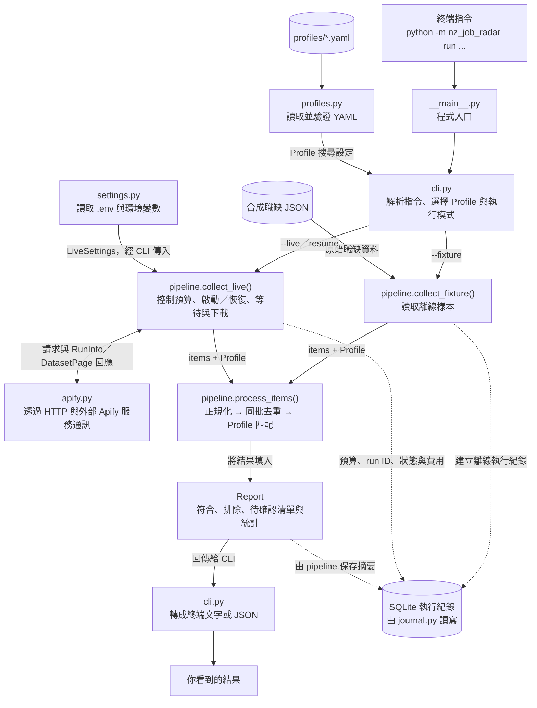
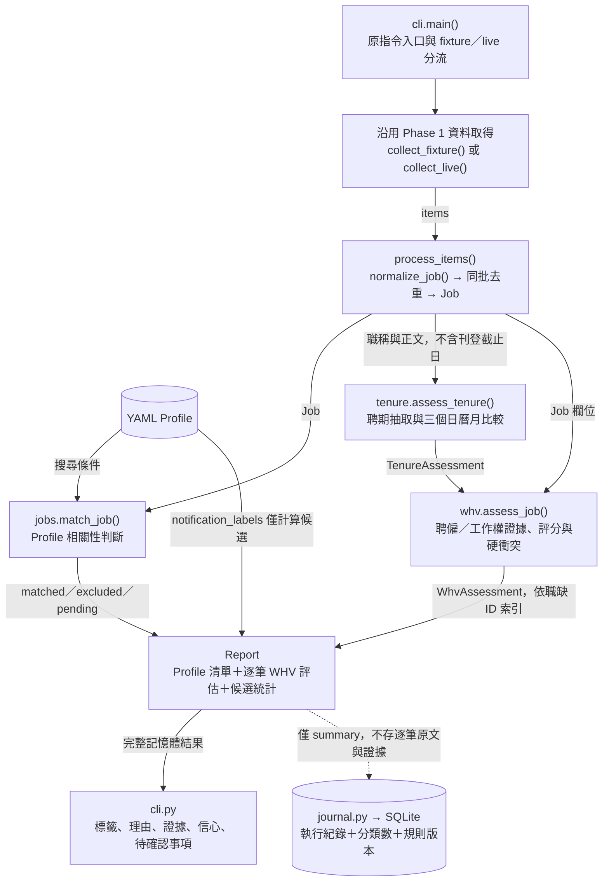
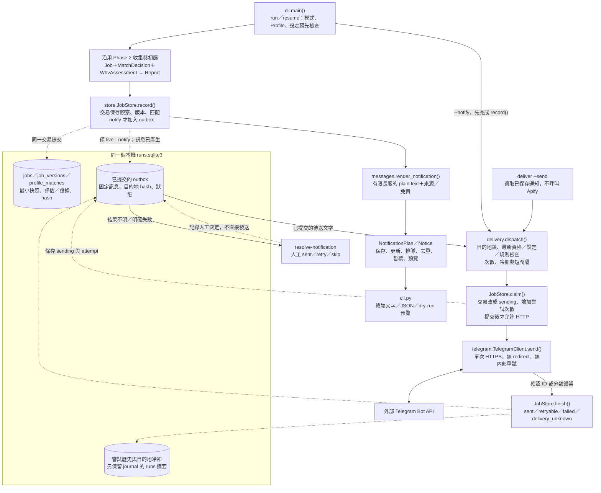

# 程式架構與資料流

本文件用來理解專案的入口、模組職責與資料如何傳遞，不取代 [MVP 規格](../NZ_WORKING_HOLIDAY_JOB_RADAR_SPEC.md)或 [README 操作說明](../README.md)。

目前收錄：**Phase 1、Phase 2 與 Phase 3 架構快照（2026-09-23）**。
Phase 1、Phase 2 章節保留供對照；目前程式行為以後面的 Phase 3 章節為準。各階段有獨立架構圖，不以新圖覆蓋歷史快照。

圖使用 Mermaid，請在支援 Mermaid 的 Markdown 預覽中閱讀。若編輯器只顯示圖的原始碼，仍可先讀各節的文字說明。

## Phase 1：Profile → 取得職缺 → 整理與匹配 → 列出結果

### 1. 先建立整體概念

目前是一支「執行一次、處理一批資料、顯示結果後結束」的 Python CLI 程式。
CLI 是 Command-Line Interface，也就是透過終端指令操作程式。

圖中的節點是同一支程式內的模組／函式，不是各自獨立運作的服務。只有 Apify 是本機以外的外部服務。

- **Profile**：我要找什麼工作。
- **資料來源**：從本機合成樣本，或透過 Apify 取得職缺。
- **處理流程**：整理欄位、同批去重、判斷是否符合 Profile。
- **輸出**：終端文字或 JSON，以及本機執行摘要。

Phase 1 的 `matched` 只代表符合搜尋 Profile，**不代表符合 WHV 條件，也不會發送 Telegram**。
本版離線流程已驗證；live 程式路徑經 HTTP mock 測試，尚未做本版真實來源驗收，詳見 [Phase 1 驗證紀錄](phase1-verification.md)。

### 2. 架構圖

以下畫的是 `run` 命令的主要流程，並標出 `resume` 共用的 live 路徑。
README 的免費離線練習走左邊，不讀 `.env`、不呼叫 Apify。



實線表示主要控制／資料路徑，虛線表示寫入本機紀錄。這是概念架構圖，不是逐行執行圖；部分物件建立、回傳與錯誤分支已省略。

最重要的關係：**離線與 live 的資料取得方式不同，但後面的整理、去重與匹配共用同一套程式。**

### 3. 入口：指令如何進入 Python？

以這行為例：

```bash
python -m nz_job_radar profiles
```

1. `python -m nz_job_radar` 要求 Python 執行這個 package 的 `__main__.py`。
2. `__main__.py` 呼叫 `cli.entrypoint()`。
3. `entrypoint()` 設定終端輸出編碼，再呼叫 `main()`。
4. `main()` 使用 `parser()` 解析 `profiles`、`run`、`runs` 等子命令和參數。
5. 依照命令執行對應流程，最後回傳 exit code 並結束程序。

安裝專案後也可使用 `nz-job-radar` 命令；它由 [pyproject.toml](../pyproject.toml) 設定，直接進入同一個 `cli.entrypoint()`。

### 4. 各個節點負責什麼？

| 檔案 | 職責 | 可以把它想成 |
|---|---|---|
| [__main__.py](../src/nz_job_radar/__main__.py) | 接到 `python -m nz_job_radar` 後，呼叫 CLI 入口 | 大門 |
| [cli.py](../src/nz_job_radar/cli.py) | 解析參數、選擇要做的事、顯示結果、處理最外層錯誤 | 接待與指令分派 |
| [profiles.py](../src/nz_job_radar/profiles.py) | 把 YAML 讀成經過驗證的 `Profile` 物件 | 搜尋條件讀取器 |
| [settings.py](../src/nz_job_radar/settings.py) | live 時讀取 Token、許可旗標、費用與時間上限 | 執行環境設定 |
| [pipeline.py](../src/nz_job_radar/pipeline.py) | 安排先取得資料、再處理、再保存摘要的順序 | 流程協調者 |
| [apify.py](../src/nz_job_radar/apify.py) | 發送 API 請求，讀取執行狀態與職缺分頁 | 對外通訊窗口 |
| [jobs.py](../src/nz_job_radar/jobs.py) | 整理單筆職缺、判斷是否符合 Profile | 資料處理與匹配規則 |
| [journal.py](../src/nz_job_radar/journal.py) | 保存執行紀錄、預算與統計，支援恢復讀取 | 執行紀錄簿 |

這樣拆開，是讓「怎麼取得資料」「怎麼判斷資料」「怎麼顯示資料」各自有清楚的位置。
例如更改標題排除規則，主要看 `jobs.py`；更改終端呈現，主要看 `cli.py`。

### 5. 資料究竟怎麼傳？

模組之間主要透過**函式參數與回傳值**傳遞 Python 物件，不是每一步都先寫檔，再讓下一個模組讀檔。
可以把資料物件想成欄位固定的「資料盒子」，讓不同函式知道要從哪個欄位取資料。

#### 5.1 Profile：我要找什麼？

例如 YAML 中有這些欄位（局部示意，不是完整 Profile）：

```yaml
locations: [Auckland]
keywords: [cafe assistant, front of house]
```

`load_profiles()` 讀取並驗證整個設定資料夾，回傳以 ID 為索引的 `dict[str, Profile]`。CLI 再挑出使用者指定的一個：

```python
profiles = load_profiles(args.profiles_dir)
profile = profiles.get(args.profile)
```

之後其他函式可以直接使用 `profile.locations`、`profile.keywords` 等欄位。
Profile 不是職缺，而是**用來搜尋與篩選職缺的條件**。

live 時，`build_actor_input(profile)` 把關鍵字、地區與上限等轉成 Apify 接受的查詢格式。
`exclude_title` 與 `employers` 則在本地匹配階段檢查，不是直接送給 Actor 的篩選欄位。

#### 5.2 原始資料 → Job → MatchDecision

離線 JSON 或 Apify 的資料，讀進 Python 後先是字典清單 `items`，型別為 `list[dict[str, object]]`。
`process_items()` 逐筆處理，每次拿到一個原始字典 `raw`。

核心呼叫如下；兩行之間實際還有同批職缺 ID 去重：

```python
job = normalize_job(raw)
decision = match_job(job, profile)
```

| 資料 | 代表什麼 | 例子 |
|---|---|---|
| `raw` | 來源提供的原始字典 | 原始欄位 `company`、`canonicalUrl` |
| `Job` | 整理成統一欄位的單筆職缺 | `employer`、`source_url`、`title`、`location` |
| `MatchDecision` | 是否符合 Profile，以及判斷原因 | `excluded` 搭配 `location_mismatch` |

`normalize_job()` 驗證 SEEK URL／ID、整理欄位、清理正文，並盡力遮蔽聯絡資訊。
`match_job()` 檢查國別、地點、關鍵字、職稱排除與雇主條件。

判斷狀態有三種：

- `matched`：符合搜尋 Profile。
- `excluded`：已知有不符合的條件。
- `needs_confirmation`：必要資訊不明，需要確認；不是 WHV 黃標。

無效資料會計入 `invalid` 並跳過；同批相同 ID 會計入 `duplicates`。
因此 `fetched` 是原始取得筆數，不等於符合筆數，也包含無效與重複項目。

#### 5.3 Report：這次處理的完整結果

收集函式先建立 `Report`，再交給共同處理函式：

```python
process_items(report, items, profile)
```

這個函式**不是回傳新的報告，而是直接修改傳進去的 `report`**，把結果放進：

```python
report.matched  # 符合 Profile 的職缺
report.excluded  # 被排除的職缺與原因
report.pending  # 資訊不足，待確認的職缺與原因
```

其中 `matched` 是 `Job` 清單；`excluded` 和 `pending` 則保存 `(Job, MatchDecision)` 配對。
Report 還包含數量、run／dataset ID、費用資訊、警告與資料完整性狀態。

最後由 `collect_fixture()` 或 `collect_live()` 把完整 Report 回傳給 CLI。例如離線路徑：

```python
report = collect_fixture(profile, fixture, journal)
```

CLI 再用 `render_report()` 轉成終端文字，或用 `report_payload()` 整理成可輸出 JSON 的資料。

#### 5.4 記憶體與 SQLite 不一樣

完整 Report 包含職缺清單，存在這次 Python 程序的記憶體中。
pipeline 交給 `Journal.finish()` 保存的則是：

```python
report.summary()
```

也就是執行識別碼、數量、原因統計、警告、費用等摘要，不是完整職缺清單。

預設資料庫是 `data/runs.sqlite3`。目前只包含執行紀錄 `runs` 表，保存：

- 本機 attempt ID、Profile ID 與設定指紋、執行模式和狀態。
- Apify run ID、dataset ID、回讀 API 狀態與費用。
- 本地預算預留、時間、錯誤碼與統計摘要。

**目前不保存原始 dataset、完整 Job、職缺正文或通知紀錄。** 程式結束後，不能靠 `runs` 還原那批完整職缺。
同批去重所用的 `seen` 集合也是每次重新建立，不等於跨次去重。

### 6. 對應 README 的四行免費離線練習

在專案根目錄、已啟用 venv 的 Git Bash 執行：

```bash
python -m nz_job_radar profiles
python -m nz_job_radar run --profile auckland-cafe-service --fixture tests/fixtures/phase1/seek-synthetic.json --show-excluded
python -m nz_job_radar run --profile nz-ski-fields --fixture tests/fixtures/phase1/seek-synthetic.json --show-excluded
python -m nz_job_radar runs
```

| 指令 | 實際走的路徑 |
|---|---|
| `profiles` | CLI → 讀取 YAML → 列出 Profile 名稱與 ID；不取得職缺 |
| 咖啡 `run --fixture` | 咖啡 Profile＋合成資料 → 共用處理流程 → 顯示結果、保存摘要 |
| 滑雪場 `run --fixture` | 滑雪場 Profile＋同一份合成資料 → 共用處理流程 → 顯示結果、保存摘要 |
| `runs` | CLI → SQLite → 列出最近 30 筆本機執行紀錄；不重新匹配、不呼叫 Apify |

第二、第三行不是兩套不同程式，而是：

> 同一套處理程式＋同一份樣本，換一份 Profile，得到不同結果。

以本階段的 8 筆合成樣本和預設 Profile 為例，咖啡符合 2 筆、排除 6 筆；滑雪場符合 2 筆、排除 5 筆、待確認 1 筆。
這些是[合成測試資料](../tests/fixtures/phase1/README.md)，不是可應徵的真實職缺。
兩個 `run --fixture` 會各新增一筆本機執行紀錄，但不會產生抓取費用。

### 7. live 路徑多了哪些事情？

離線模式直接讀檔；live 模式多出設定驗證、預算控制與遠端工作管理。

1. CLI 讀取 `LiveSettings`，檢查來源許可旗標、Token、費用與時間設定。
2. pipeline 建立 Actor 查詢，透過 Journal 檢查未完成執行及預算，預留本次金額。
3. `ApifyClient.start_run()` 啟動遠端工作，回傳 `RunInfo`。
4. pipeline 保存 run ID，透過 `_poll()` 定期讀取狀態，直到成功、失敗或停止等待。
5. `_download()` 讀取各個 `DatasetPage`，組成原始職缺字典清單。
6. 進入和離線模式相同的 `process_items()`，最後回傳 Report。

三個容易混淆的名詞：

| 名詞 | 所在位置 | 意義 |
|---|---|---|
| Attempt | 本機 | 這次操作的本地紀錄，包含狀態及預算預留 |
| Run | Apify | 一次遠端 Actor 執行工作 |
| Dataset | Apify | 該工作輸出的職缺資料容器 |

`resume` 也使用 `collect_live()`，但先讀回原本 Attempt，驗證 Profile 與 run 綁定，再讀取既有 run；**不再呼叫 `start_run()`**。
恢復下載會從原 dataset 的第一頁重新讀取，不是從本機保存的半份職缺接續。

本機停止等待不代表遠端工作停止；`resume` 的目的，是避免為了恢復讀取而重新啟動一筆可能計費的工作。
來源許可未確認前仍使用離線模式；架構圖中的 live 路徑不代表已經完成真實來源驗收。

### 8. 建議的第一輪程式閱讀順序

先沿著已經跑成功的離線路徑，不必一開始就深入 HTTP 重試與 SQLite 細節：

1. `__main__.py`：找出它呼叫哪個函式。
2. `cli.py` 的 `entrypoint()`、`main()`：看指令如何分流，以及 `--profile` 如何選設定。
3. `pipeline.py` 的 `collect_fixture()`：看資料從哪裡來、Report 何時建立、何時保存摘要。
4. 同檔案的 `process_items()`：看逐筆處理、去重、結果分類，以及 Report 的原地修改。
5. `jobs.py` 的 `normalize_job()`、`match_job()`：追一筆職缺如何變成 Job，再得到匹配決策。
6. 回到 `cli.py` 的 `render_report()`：看記憶體中的資料如何變成終端文字。

讀完後，試著不看本文回答：

- 換 Profile 為什麼不需要重寫整套程式？
- `normalize_job()` 與 `match_job()` 各自改變或產生什麼？
- 為什麼 `process_items()` 沒有回傳 Report，呼叫後 Report 卻有資料？
- 為什麼 `runs` 看得到統計，卻不能還原完整職缺清單？
- 為什麼 Profile 的 `matched` 不代表 WHV 適合？

## Phase 2：加入 WHV 初篩與可解釋的結果

### 1. 相較 Phase 1，改變了什麼？

入口、兩種資料來源、Profile、本地預算及 Apify 恢復流程不變。
新增 `tenure.py` 的聘期抽取與 `whv.py` 的分類，接入原本的 `process_items()`。
同一筆職缺現在有兩個獨立問題：

1. **Profile 匹配**：是不是我要找的地點、職稱與雇主？
2. **WHV 初篩**：廣告中可辨識的聘僱條件，是否可能符合台灣 WHV 限制？

第二個判斷不是簽證核准或法律保證，也不會自動刪除不相容的職缺。

### 2. Phase 2 架構圖



箭頭表示資料依賴，不表示開啟多個程序或同時執行。實際仍在同一個 Python 程序內逐筆處理。
沒有 Telegram 節點，因為通知佇列與發送仍留待 Phase 3。

### 3. 新增的節點與資料物件

| 節點／物件 | 職責與資料 |
|---|---|
| [tenure.py](../src/nz_job_radar/tenure.py) | `assess_tenure(text)` 抽取任職期間；`add_calendar_months()` 處理月底／跨年／閏年 |
| `TenureAssessment` | 期間狀態 compatible／exceeds_limit／unknown／boundary、明示起訖日、證據與原因 |
| [whv.py](../src/nz_job_radar/whv.py) | `assess_job(job, today=...)` 整合聘期與聘僱／工作權文字，產生保守分類 |
| `WhvAssessment` | label、score、confidence、reasons、evidence、questions、tenure、規則版本／日期與來源 |
| `Report.whv_assessments` | 用職缺 ID 對應該筆評估，包含 Profile 排除／待確認者 |
| `Report.notification_candidates` | 符合 Profile 且標籤在通知設定內的 ID 集合；不是待送佇列 |

`Job` 與 `MatchDecision` 沒有被 WHV 標籤取代。Profile 的 `needs_confirmation` 是搜尋資訊待確認，WHV 的同名標籤是聘僱／簽證條件待確認，兩者要分開看。

### 4. 每筆資料的呼叫順序

在 `process_items()`，核心順序可理解為以下摘錄（省略錯誤、去重及統計細節）：

```python
job = normalize_job(raw)
decision = match_job(job, profile)
assessment = assess_job(job, today=date.fromisoformat(report.assessed_at))
report.whv_assessments[job.source_job_id] = assessment
```

接著依 `decision` 把 Job 放到原本三種 Profile 清單。
只有 Profile 符合且 `assessment.label` 在 `profile.notification_labels` 裡，才把 ID 加入通知政策候選集合。
不相容標籤仍保留在結果列表，不因預設不通知而刪掉。

`assess_job()` 內部先取得聘僱與工作權證據，並呼叫 `assess_tenure()`；先看硬性衝突，再看必要條件與分數。
缺少資訊不補成有利條件；規則超過 90 天未查核時警告並暫不給綠標。細節見 [WHV 規則說明](whv-rules.md)。

### 5. 輸出與保存的差別

- 終端預設仍列 Profile 符合的全部職缺，現在每筆加上 WHV 標籤與證據；`--show-excluded` 顯示其餘 Profile 分類。
- JSON 的 `jobs` 保留原本 Job 欄位，另外增加 `whv` 與 `notification_eligible`；不相容者不會從 jobs 消失。
- `summary.whv_counts` 是 Profile 符合者的分類數；`whv_all_counts` 是全批有效去重者的分類數。
- SQLite 新增保存上述彙總及 `whv_rules`／`notification_policy` 摘要，不保存原文、逐筆證據或完整 Job。
- 舊 Phase 1 run 保持原紀錄，不回填成 Phase 2 結果。

### 6. Phase 2 的閱讀順序與練習

1. 先看 `pipeline.process_items()`，找出新增的 `assess_job()` 呼叫。
2. 看 `whv.assess_job()`，分清楚分數、硬性衝突與綠標必要條件。
3. 看 `tenure.assess_tenure()`，了解日期與「三個月」為何不能直接等於 90 天。
4. 回到 `Report.summary()`、CLI 的 `_assessment_lines()` 與 `report_payload()`，追蹤資料怎麼顯示。
5. 讀 [Phase 2 樣本索引](../tests/fixtures/phase2/README.md)，再跑：

```bash
python -m nz_job_radar run --profile auckland-cafe-service --fixture tests/fixtures/phase2/seek-synthetic.json
```

試著解釋：為什麼「Full time」不一定是紅標？為什麼 casual 未寫聘期是黃標？為什麼紅標仍顯示？為什麼候選數不代表已送 Telegram？

## Phase 3：職缺保存、通知佇列與可恢復發送

### 1. 相較 Phase 2，改變了什麼？

取得資料與 WHV 初篩仍沿用 Phase 2。新增的是跨次職缺觀察、通知去重與可恢復發送；`Report.notification_candidates` 現在只是排隊前的候選，還要經過保存、目的地與版本檢查。

預設 `run` 保存職缺但不排隊、不發送。`--dry-run` 保存觀察並顯示預覽，不改 outbox；只有明確的 live `--notify` 建立待送並嘗試發送。`deliver --send` 只處理已保存的待送資料，不經過 Apify。

### 2. Phase 3 架構圖



仍是手動啟動、執行完結束的單一 Python CLI，沒有背景 worker 或排程。SQLite 節點表示同一個資料庫內不同用途的資料，不是多個資料庫服務。

最重要的順序是：**交易保存並提交 outbox → 取得發送權並提交 `sending` → 呼叫 Telegram → 保存結果**。外部 HTTP 不放在保存職缺的交易內；失敗不會抹掉已取得的職缺。

### 3. 新增的模組與資料物件

| 模組／物件 | 職責 |
|---|---|
| [store.py](../src/nz_job_radar/store.py)／`JobStore` | 保存跨次觀察與版本、Profile 匹配、outbox、嘗試歷史及冷卻；不呼叫 HTTP |
| `Notice` | 一筆已產生的訊息：canonical Job ID、版本、new／update、文字及可選 outbox ID |
| `NotificationPlan` | 此次保存、新職缺、更新、排隊、去重、暫緩數量與通知清單 |
| [messages.py](../src/nz_job_radar/messages.py) | 將 Job／WhvAssessment 轉成單則有限長度的純文字，保留連結與免責 |
| [delivery.py](../src/nz_job_radar/delivery.py) | 檢查資格，claim 已提交通知，管理有限重試、節流及結果保存 |
| [telegram.py](../src/nz_job_radar/telegram.py)／`TelegramClient` | 單次送出與嚴格驗證回覆；成功回傳正整數 message ID |
| `TelegramError` | 本機安全錯誤碼與 retryable／failed／delivery_unknown 結果；可附 retry_after |
| [locking.py](../src/nz_job_radar/locking.py) | 同一 state 目錄內的 Profile／目的地程序鎖，避免重疊處理 |

`Report.notifications` 把 `NotificationPlan` 與可選的發送摘要交回 CLI。候選、排隊、已送與暫緩是不同計數，不能再把候選數當成已送達數。

### 4. 跨次識別與保存範圍

職缺使用已驗證 SEEK URL 的數字 ID。重要版本 hash 比較職缺主要欄位、正規化內文與關鍵分類結果；目的地 hash 區分不同 Chat。通知唯一範圍是 `mode + job_id + version + destination_key`，不包含 Profile ID，因此跨 Profile 命中同一版本不重複排隊。

排版／HTML／空白／大小寫、刊登日、廣告截止日、觀察時間與單純查核日期字串不獨立觸發新版本。實際內容、分類或規則版本改變才可能形成重要更新；本次沒出現的職缺不自動視為下架。

與 Phase 2 不同，現在 SQLite 會保存逐筆最小快照、WHV 評估與必要證據、內文 hash、Profile 匹配及通知紀錄。快照排除完整內文；不保存原始 provider payload、Token 或原始 Chat ID。原本 `runs` 仍負責執行摘要，舊 Phase 1／2 run 不會被回填成新階段的結果。

fixture／live 使用分開的模式識別。fixture 只供合成資料練習與預覽，不能建立真實 Telegram 待送；即使 ID 相同，也不與 live 共用送達紀錄。

### 5. 發送權、重試與人工決定

`claim()` 在交易內核對目前版本、最新可通知匹配、目的地、狀態、冷卻與剩餘次數。發送器另外核對目前啟用的 Profile fingerprint 和仍在 90 天內的規則查核日期。outbox 的訊息快照不會在 `deliver` 時依設定重寫；條件改變時先重新觀察／預覽。

明確的 `--notify` 新觀察若仍是同一重要版本、仍符合資格，且查核日期較新，可刷新現有 `pending`／`retryable` 的文字與規則日期；不重設嘗試次數、退避或冷卻。dry-run 只預覽這項變化，不更動 outbox。

每筆通知自動最多嘗試 3 次並保存次數。明確未送出的連線失敗只短暫等待 1／2 秒；確認的 429 把目的地冷卻寫入資料庫並結束當批，重啟不會清掉冷卻。不同目的地獨立，不能靠處理同 Chat 的下一筆訊息跳過等待。

timeout 不必然等於沒送達。回應讀取／寫入／協定不明、異常回覆或遺留的 `sending` 到期，會進入 `delivery_unknown`。它不自動重播，也暫緩同職缺同目的地的其他版本；人工核對後透過 `resolve-notification` 選擇已送、retry 或 skip，留下歷史。

這是保守的恢復機制，不是端到端 exactly-once 保證。若 HTTP 已成功但本地 `sent` 提交失敗，後續也按結果不明處理，不能因資料庫沒有成功狀態就盲目重送。

### 6. Phase 3 的閱讀順序與練習

1. 在 `cli.main()` 找 `store.record()`，區分普通執行、`--dry-run` 與 `--notify`。
2. 看 `store.important_version()`、`record()`，追蹤職缺如何變成快照、版本與可選 outbox。
3. 看 `messages.render_notification()`，了解為什麼大段內文不會直接變成一大則通知。
4. 看 `delivery.dispatch()` 和 `store.claim()`／`finish()`，分清楚排隊、取得發送權及確認送達。
5. 最後看 `TelegramClient.send()`，區分可重試的拒絕與無法確定是否送達的錯誤。

先用 [通知操作說明](notifications.md#2-先做免費離線預覽)的 fixture 命令練習，不需要 Token。試著回答：為什麼 dry-run 仍保存職缺？為什麼更改 YAML 不會直接重寫待送訊息？為什麼發送成功卻保存失敗時不能立即再送？

## Phase 4：驗證流程與交付證據

Phase 4 驗證前面三個階段已串接的流程，沒有新增常駐服務或新的 production 元件，因此保留三張既有架構圖，不另畫一張重複的產品架構。

本節描述驗證路徑；實際結果與尚待完成的證據見 [Phase 4 驗證紀錄](phase4-verification.md)。

驗證順序為：離線檢查與 fixture → 完整 HTTP mock → 確認來源許可及費用／通知上限 → 小型 Profile 副本的 live 預覽 → 同 run 的 `resume --notify` → API 證據與人工收件核對。具體 Git Bash 指令見 [Phase 4 驗收指南](acceptance-guide.md)。

| 驗證路徑 | 連到哪一段架構 | 保留什麼證據 |
|---|---|---|
| 離線 fixture／mock | 同一套 Profile、pipeline、WHV、store 與 delivery；外部回覆受測試控制 | 檢查結果、預期分類、交易與恢復行為 |
| 限額 live `run --dry-run` | 真實 Apify → 既有 Phase 2／3 處理 → 本機保存及預覽 | attempt／run／dataset ID、有限搜尋結果、費用與警告 |
| 同 run `resume --notify --notify-limit 3` | 讀回原 dataset → 同一 Profile 初篩 → outbox → Telegram | 職缺／版本／outbox 與已確認 message ID |
| 人工收件核對 | 使用者查看目的 Chat | 對應職缺是否實際顯示、內容與連結是否可理解 |

本次 live 使用 `data/live-smoke-profiles` 的縮小上限副本，保留原 Profile ID；預覽與 resume 之間不可修改設定 fingerprint。`--state-dir data` 沿用既有預算／通知資料庫，fixture 驗證另用測試 state 目錄。

`--notify-limit` 限定 run／resume 這次處理的通知筆數，不新增一層通知服務，也不控制 Apify 取得量。來源結果／頁數上限仍由 Profile 控制；本次每個 Profile 的累積通知額度仍需由操作紀錄確認。

測試通過、來源成功、API 接受與人工收到是四種不同證據。零候選、達上限或 partial 不能單獨證明完整通知流程；驗收結論必須保留未完成項目，不能把架構圖當作實際通過的證明。

## 後續階段的文件維護方式

- 保留本文件的 Phase 1 架構圖與說明，作為學習和回顧基準。
- Phase 2、Phase 3 已各自新增獨立章節與架構圖；之後若經確認擴充其他階段，以相同方式追加新增模組、資料物件與資料流。
- 不把未實作的節點混進 Phase 1，也不以新圖覆蓋舊圖。
- 原始碼可能隨開發移動，因此本文以檔案與函式名稱定位，不依賴固定行號。

相關文件：[README](../README.md)、[Roadmap](../MVP_ROADMAP.md)、[Phase 1 驗證紀錄](phase1-verification.md)、[通知操作說明](notifications.md)。
